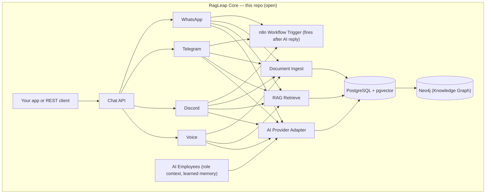
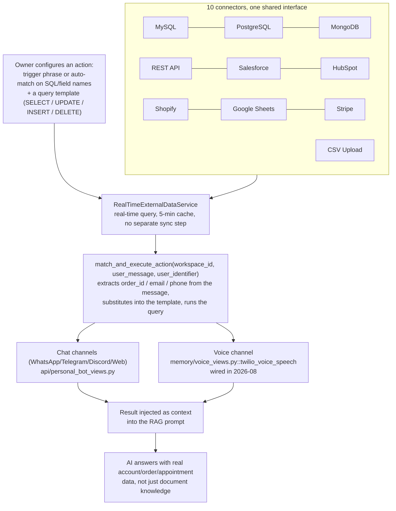

<div align="center">


# RagLeap Core

**Open-Source-KI-Mitarbeitende, die nachfragen, bevor sie handeln.**

[](../LICENSE) [](https://github.com/ragleap/ragleap-core/releases) [](https://github.com/ragleap/ragleap-core) [](https://github.com/ragleap/ragleap-core) [](https://github.com/ragleap/ragleap-core)
[](https://pypi.org/project/ragleap-rag/) [](https://pypi.org/project/ragleap-rag/)
[](https://pypi.org/project/ragleap-graph/) [](https://pypi.org/project/ragleap-graph/)
[](https://pypi.org/project/ragleap-vectorstores/) [](https://pypi.org/project/ragleap-vectorstores/)
[](https://pypi.org/project/ragleap-tools/) [](https://pypi.org/project/ragleap-tools/)
[](https://pypi.org/project/ragleap-integrations/) [](https://pypi.org/project/ragleap-integrations/)
[](https://pypi.org/project/ragleap-agents/) [](https://pypi.org/project/ragleap-agents/)
[](https://pypi.org/project/ragleap-ops/) [](https://pypi.org/project/ragleap-ops/)
[](https://pypi.org/project/ragleap-app-chart/) [](https://pypi.org/project/ragleap-app-chart/)
[](https://pypi.org/project/ragleap-observability/) [](https://pypi.org/project/ragleap-observability/)
[](https://pypi.org/project/ragleap-terraform/) [](https://pypi.org/project/ragleap-terraform/)
[](https://pypi.org/project/ragleap-ansible/) [](https://pypi.org/project/ragleap-ansible/)
[](https://pypi.org/project/ragleap-voice/) [](https://pypi.org/project/ragleap-voice/)
[](https://pypi.org/project/ragleap-memory/) [](https://pypi.org/project/ragleap-memory/)
[](https://pypi.org/project/ragleap-security/) [](https://pypi.org/project/ragleap-security/)
[)](https://central.sonatype.com/artifact/io.github.antonyrag/ragleap-rag)
[)](https://central.sonatype.com/artifact/io.github.antonyrag/ragleap-graph) [)](https://central.sonatype.com/artifact/io.github.antonyrag/ragleap-vectorstores)
[](https://github.com/ragleap/ragleap-core) [](https://discord.gg/mQwJuQDVrA) [](https://github.com/ragleap/ragleap-core/pulse)

[English](../README.md) · [Afrikaans](README.af.md) · [العربية](README.ar.md) · [Български](README.bg.md) · [বাংলা](README.bn.md) · [Català](README.ca.md) · [Čeština](README.cs.md) · [Cymraeg](README.cy.md) · [Dansk](README.da.md) · [Deutsch](README.de.md) · [Ελληνικά](README.el.md) · [Español](README.es.md) · [Eesti](README.et.md) · [فارسی](README.fa.md) · [Suomi](README.fi.md) · [Français](README.fr.md) · [ગુજરાતી](README.gu.md) · [עברית](README.he.md) · [हिन्दी](README.hi.md) · [Hrvatski](README.hr.md) · [Magyar](README.hu.md) · [Bahasa Indonesia](README.id.md) · [Italiano](README.it.md) · [日本語](README.ja.md) · [ಕನ್ನಡ](README.kn.md) · [한국어](README.ko.md) · [Lietuvių](README.lt.md) · [Latviešu](README.lv.md) · [Македонски](README.mk.md) · [മലയാളം](README.ml.md) · [मराठी](README.mr.md) · [नेपाली](README.ne.md) · [Nederlands](README.nl.md) · [Norsk](README.no.md) · [ਪੰਜਾਬੀ](README.pa.md) · [Polski](README.pl.md) · [Português](README.pt.md) · [Română](README.ro.md) · [Русский](README.ru.md) · [Slovenčina](README.sk.md) · [Slovenščina](README.sl.md) · [Soomaali](README.so.md) · [Shqip](README.sq.md) · [Svenska](README.sv.md) · [Kiswahili](README.sw.md) · [தமிழ்](README.ta.md) · [తెలుగు](README.te.md) · [ไทย](README.th.md) · [Tagalog](README.tl.md) · [Türkçe](README.tr.md) · [Українська](README.uk.md) · [اردو](README.ur.md) · [Tiếng Việt](README.vi.md) · [简体中文](README.zh-cn.md) · [繁體中文](README.zh-tw.md)

</div>

RagLeap Core ist die Open-Source-Engine hinter RagLeap — ein selbst gehostetes, agentisches System, das Ihr Unternehmen anhand Ihrer eigenen Dokumente auf Ihrem eigenen Server unterstützt, ohne Bindung an einen Anbieter.

**46 rollenbasierte KI-Mitarbeitende:** 9 allgemeine Kernrollen (KI-Manager, Assistenz, CEO, Vertrieb, Support, Personalwesen, Finanzen, Marketing und Betrieb) sowie 37 branchenbezogene globale Rollen (Recruiting, Immobilien, juristische Erstaufnahme, medizinische Erstaufnahme, Versicherungen und mehr) — die vollständige Liste steht in [`core/employees/defaults.py`](../core/employees/defaults.py).

**Das kann RagLeap Core:**
- Selbstlernendes Gedächtnis, gewichtet nach Ergebnissen
- Automatisch ausgelöste Workflows und Eskalationen
- Autonomiemodi: `off` (Standard; die KI handelt nur, wenn Sie sie starten), `semi` (Sie genehmigen jede Aktion) und `full` (optional; sensible Rollen sind nie vollständig autonom)
- Denk-, Handlungs- und Entscheidungszyklus statt bloßer Suche
- Optionaler Agentenzyklus aus Handeln und Beobachten: Das Modell schlägt jeweils eine Aktion vor, jede Aktion durchläuft die Freigabe, und das Ergebnis kommt als nicht vertrauenswürdiger Text zurück
- Sichere, optionale Werkzeuge: Python und Shell in einer sandbox ohne Netzwerk, schreibgeschützter Seitenabruf, ein MCP-Client mit Zulassungsliste, Aufgabentickets und geplante Rückfragen
- **AI-Office-Dashboard** unter `/office`: Freigaben, Mitarbeitende nach Abteilung, Aufgaben, Agentenläufe, Aktivitäten, Einstellungen und eine Einrichtungs-Checkliste
- Vollständig lokal mit Ollama für Chat und Embeddings nutzbar (kleine Modelle sind auf einer CPU langsamer und ungenauer als gehostete Modelle) oder mit einem der 19 Anbieter und Ihrem eigenen Schlüssel
- Optionale Tokenbudgets, Drosselung fehlgeschlagener Anmeldungen und ein Auditprotokoll aller Aktionen

**Installation mit einem Befehl** (erfordert Docker Desktop unter macOS und Windows oder Docker Engine unter Linux; das Skript fragt nach der gewünschten KI und ändert eine vorhandene `.env`-Datei nicht):

```bash
curl -fsSL https://raw.githubusercontent.com/ragleap/ragleap-core/main/install.sh | bash
```

Möchten Sie das Skript zuerst lesen? Siehe [install.sh](../install.sh). Für eine vollständig lokale Einrichtung ohne API-Schlüssel hängen Sie an den Befehl `bash -s -- --ollama` an.

**Windows:** Installieren Sie [Docker Desktop](https://www.docker.com/products/docker-desktop) (erfordert WSL 2 und aktivierte CPU-Virtualisierung) und [Git for Windows](https://git-scm.com/download/win). Führen Sie dann in einem geöffneten PowerShell-Fenster Folgendes aus:

```powershell
irm https://raw.githubusercontent.com/ragleap/ragleap-core/main/install.ps1 | iex
```

Das Skript fragt nach der gewünschten KI, erstellt und startet RagLeap und öffnet das Dashboard im Browser, ohne den Anmeldeschlüssel im Terminal auszugeben. Geben Sie den Befehl direkt in PowerShell ein: In der Form `powershell -c "..."` wurde er auf dem einen getesteten Rechner von Windows Defender blockiert. Um das Skript zuerst zu lesen, führen Sie `$s = irm` mit derselben Adresse aus, prüfen Sie `$s` und starten Sie es anschließend mit `iex $s`. Nach der Installation führen Sie RagLeap-Befehle in Git Bash aus dem Installationsordner aus, zum Beispiel `bash scripts/ragleap key`.

Wenn Port 8000 oder 5433 bereits auf Ihrem Computer belegt ist (zum Beispiel durch ein lokales PostgreSQL), wählt eine Neuinstallation den nächsten freien Port und trägt ihn in `.env` ein (`APP_PORT`, `DB_PORT` usw.). `ragleap key --rotate` ersetzt Ihren API-Schlüssel und startet die App neu; der alte Schlüssel wird sofort ungültig.

**Bekannte Grenzen:** Das Windows-Installationsprogramm wurde bisher auf einem Windows-Rechner ausgeführt; die lokale Ollama-Option wurde unter Windows noch nicht getestet.

[Schnellstart](#schnellstart) · [Dokumentation](https://docs.ragleap.com) · [Website](https://ragleap.com) · [Pakete](https://packages.ragleap.com/)

---

> **Open Source und selbst gehostet.** `ragleap-core` (dieses Repository) steht unter der MIT-Lizenz, ist vollständig kostenlos und benötigt nie einen Lizenzschlüssel. RagLeap ist für den Self-Hosting-Betrieb ausgelegt; derzeit wird kein verwalteter Cloud-Dienst angeboten.

## Installation

```bash
pip install ragleap-rag
```

> ⭐ Wenn Ihnen dieses Projekt hilft, geben Sie dem Repository gern einen Stern — so finden mehr Menschen es.

Bevorzugen Sie Java? `ragleap-rag` ist auch auf Maven Central verfügbar:
```xml
<dependency>
    <groupId>io.github.antonyrag</groupId>
    <artifactId>ragleap-rag</artifactId>
    <version>0.13.0</version>
</dependency>
```
Die Versionierung ist unabhängig vom oben genannten Python-Paket — den aktuellen Umfang finden Sie unter [`java/ragleap-rag`](../java/ragleap-rag).

Auch der Neo4j-Graphindex hat eine Java-Portierung über die HTTP-Query-API (Regex- oder optionale LLM-gestützte Entitäts- und Relationsextraktion, Deduplizierung, Dokumentindizierung und -abfragen, `GraphRetriever`, Backfills und Migrationen sowie den Postgres-Audit-Writer):
```xml
<dependency>
    <groupId>io.github.antonyrag</groupId>
    <artifactId>ragleap-graph</artifactId>
    <version>0.3.0</version>
</dependency>
```
Den aktuellen Umfang finden Sie unter [`java/ragleap-graph`](../java/ragleap-graph).

Auch die zusätzlichen Vektor-Backends gibt es als Java-Portierung (OpenSearch, Upstash Vector und Redis Stack, jeweils über das eigene Protokoll ohne Anbieter-SDK und mit Implementierung von `VectorBackend` aus ragleap-rag):
```xml
<dependency>
    <groupId>io.github.antonyrag</groupId>
    <artifactId>ragleap-vectorstores</artifactId>
    <version>0.1.0</version>
</dependency>
```
Den aktuellen Umfang finden Sie unter [`java/ragleap-vectorstores`](../java/ragleap-vectorstores).

Installieren Sie zusätzlich `ragleap-graph`, wenn Sie den Wissensgraphen-Abruf mit Neo4j nutzen möchten:
```bash
pip install ragleap-rag ragleap-graph
```

Installieren Sie zusätzlich `ragleap-vectorstores`, wenn Sie neben den sechs integrierten Backends von ragleap-rag (Chroma, LanceDB, Redis, Upstash Vector und OpenSearch) weitere Vektor-Backends verwenden möchten:
```bash
pip install ragleap-rag ragleap-vectorstores[chroma]
# or, with uv
uv add ragleap-rag ragleap-vectorstores[chroma]
```

Installieren Sie zusätzlich `ragleap-tools`, wenn Sie fertige Werkzeuge für Tool-Aufrufe durch LLMs benötigen (Taschenrechner, Dateioperationen in einer Sandbox, Datum und Uhrzeit, Einheitenumrechnung, JSON-/CSV-Parsing und Textwerkzeuge):
```bash
pip install ragleap-rag ragleap-tools
# or, with uv
uv add ragleap-rag ragleap-tools
```

Setzen Sie Kubernetes ein? `ragleap-ops` enthält live getestete Manifeste und ein Helm-Chart für den gesamten Stack:

```bash
pip install ragleap-ops
# or, with uv
uv add ragleap-ops
```

Benötigen Sie ein allgemeines, wiederverwendbares Chart für Ihre eigene App (nicht speziell für RagLeap)? `ragleap-app-chart` akzeptiert eine beliebige Liste `services:` statt fest codierter Namen:

```bash
pip install ragleap-app-chart
# or, with uv
uv add ragleap-app-chart
```

Möchten Sie Metriken und Logs für Ihre `ragleap-ops`-Bereitstellung? `ragleap-observability` enthält Prometheus, Grafana, Loki mit Promtail sowie Alertmanager und wurde Ende-zu-Ende auf einem echten Cluster geprüft:

```bash
pip install ragleap-observability
# or, with uv
uv add ragleap-observability
```

Sollen Ihre Agenten Werkzeuge auf entfernten MCP-Servern aufrufen? `ragleap-integrations` ist ein MCP-Client, der zugelassene Werkzeuge entfernter Server in `ragleap-tools`-Tool-Objekte umwandelt (nur Streamable HTTP, Alpha-Status):

```bash
pip install ragleap-integrations
# or, with uv
uv add ragleap-integrations
```

Benötigen Sie einen kleinen Agentenzyklus für Ihr eigenes Modell? `ragleap-agents` führt jeweils eine vorgeschlagene Aktion über `ragleap-tools`-Tool-Objekte aus, mit Freigaben, ohne Anbieter-Code und ohne Datenbank (Alpha-Status):

```bash
pip install ragleap-agents
# or, with uv
uv add ragleap-agents
```

Bevorzugen Sie Terraform für einen lokalen Cluster? `ragleap-terraform` ist ein Terraform-Modul, das einen kind-Cluster erstellt und die RagLeap-Helm-Charts installiert (derzeit nur für lokale kind-Cluster):

```bash
pip install ragleap-terraform
# or, with uv
uv add ragleap-terraform
```

Bevorzugen Sie Ansible für einen frischen Ubuntu-Server? `ragleap-ansible` ist eine Sammlung von Ansible-Rollen, die einen Deployment-Benutzer anlegen, sudo und automatische Updates einrichten und optional SSH härten sowie eine Firewall aktivieren. k3s, Helm oder die Charts werden noch nicht installiert; getestet wurde es bisher nur in einem Container:

```bash
pip install ragleap-ansible
# or, with uv
uv add ragleap-ansible
```

Interessieren Sie sich für offene, lokal ausführbare Sprachmodelle? `ragleap-voice` ist ein Modellmanager im Pre-Alpha-Status: ein lizenzgeprüftes Manifest möglicher Speech-to-Text- und Text-to-Speech-Modelle mit per Hash verifizierten Downloads von Hugging Face. Sprach-Engines gibt es noch nicht; Audio kann daher weder transkribiert noch synthetisiert werden. Alle Manifest-Einträge sind weiterhin ungeprüft:

```bash
pip install ragleap-voice
# or, with uv
uv add ragleap-voice
```

Benötigen Sie dauerhaftes, mandantenbezogenes Langzeitgedächtnis für eine LLM-App? `ragleap-memory` speichert es in einer SQLite-Datei mit FTS5-Schlüsselwortsuche, typisierten Einträgen mit Vertrauenskennzeichnungen sowie Funktionen zum Ablösen und Löschen (Alpha-Status, nicht unabhängig geprüft):

```bash
pip install ragleap-memory
# or, with uv
uv add ragleap-memory
```

Benötigen Sie Mandantenbereiche, ein manipulationssicheres Auditprotokoll und die Verwaltung geheimer Werte in einer Python-KI-App? `ragleap-security` ist ein kleines Paket aus Sicherheitsbausteinen, das nur die Python-Standardbibliothek verwendet (Alpha-Status, nicht unabhängig geprüft):

```bash
pip install ragleap-security
# or, with uv
uv add ragleap-security
```

Oder starten Sie die vollständige selbst gehostete App (Kanäle, AI-Office-Dashboard, Docker Compose) — siehe den [Schnellstart](#schnellstart) weiter unten. Alle Pakete finden Sie unter [packages.ragleap.com](https://packages.ragleap.com). Probieren Sie das Projekt mit den ausführbaren Skripten in [examples/](../examples/) aus: `01_ingest_and_query.py` (Dokument hochladen und über die API eine Frage stellen) und `02_test_channel_directly.py` (Antwortlogik eines Kanals ohne echte Bot-Zugangsdaten testen).

## Wenn ein RAG-Chatbot Fragen beantwortet, führt RagLeap Ihr Unternehmen

Die meisten Open-Source-RAG-Projekte liefern ein Werkzeugset — die App, eine Benutzeroberfläche, das Gedächtnis und die Anbindung der einzelnen Kanäle müssen Sie selbst bauen. RagLeap Core bietet eine KI für WhatsApp, Telegram, Discord und Telefonanrufe statt eines separaten, unverbundenen Bots pro Kanal. Das Gedächtnis bleibt über Sitzungen und Kanäle hinweg erhalten; Kunden müssen also nicht jedes Mal neu erkannt werden. Die Sprachfunktion verarbeitet echte eingehende Anrufe (Twilio Media Streams, Whisper STT, OpenAI TTS) und ist nicht bloß eine Dokumentenabfrage mit angehängter Telefonnummer. n8n-Workflows lassen sich direkt aus jeder Unterhaltung auslösen.

Dieses Repository enthält kein mandantenfähiges Admin-Dashboard (Einstellungen, Analysen, Team, Abrechnung) und keine Assistenzebene für Führungskräfte (Manager-KI). Enthalten ist jedoch ein Dashboard für einen einzelnen Mandanten: das AI Office unter `/office` mit Freigaben, Mitarbeitenden nach Abteilung, Aufgaben, Agentenläufen, Aktivitäten, Einstellungen und einer Einrichtungs-Checkliste. RagLeap Core selbst ist auf einen Mandanten ausgelegt, wird selbst gehostet und über `.env` konfiguriert.

## Was RagLeap Core besonders macht

Dieses Repository enthält kein allgemeines RAG-Framework, aus dessen Bausteinen Sie erst ein Produkt zusammensetzen müssen — es enthält eine echte, funktionsfähige Engine, die Sie heute ausführen können. Der Code macht transparent, dass sich das Projekt noch in einer frühen Phase befindet.

## Warum es RagLeap gibt

Open-Source-KI-Agentenprojekte wie OpenClaw wurden aus einem bestimmten Grund beliebt: Menschen wollten einen Assistenten, der auf **ihrer eigenen Infrastruktur**, mit **ihren eigenen Schlüsseln** und in **den Chat-Apps läuft, die sie bereits nutzen** — statt einer Blackbox, die jemand anderes hostet. Auf demselben Prinzip baut RagLeap Core speziell für geschäftliche KI auf.

**Ihre Schlüssel, Ihre Infrastruktur, Ihre Daten.** RagLeap Core verlangt keinen systemweiten API-Schlüssel. Sie verwenden Ihren eigenen KI-Schlüssel (oder lokales Ollama ganz ohne Schlüssel), betreiben Ihre eigene PostgreSQL-Datenbank und speichern Ihre Dokumente auf Ihrem eigenen Server. Text wird nur an die von Ihnen konfigurierten KI-Anbieter gesendet (Ihr Chatmodell und Ihr Embedding-Anbieter; verwenden Sie für beides lokales Ollama, bleiben Ihre Dokumenttexte auf Ihrem Server).

**Chat ist die Schnittstelle, kein zusätzliches Dashboard, das Sie erst erlernen müssen.** So wie OpenClaw Menschen über WhatsApp, Telegram und Slack erreicht, begegnet RagLeaps vollständige Plattform Unternehmerinnen und Unternehmern in den bereits genutzten Kanälen — WhatsApp, Telegram, Discord und echten Telefonanrufen — statt in einer weiteren App, die sie prüfen müssen.

**Ein echtes, funktionsfähiges System — kein abstraktes Framework.** RagLeap Core ist kein Werkzeugkasten wie LangChain, aus dessen Grundbausteinen Sie Ihre eigene App zusammenstellen. Es ist die konkrete Pipeline aus Aufteilung → Embeddings → Abruf → Generierung, die aus einem Produktivsystem stammt, das bereits echte Kundenfragen beantwortet und in einem Unternehmen eingesetzt wird.

**Offen und ehrlich entwickelt.** Dieses Repository zeigt klar, was fertig ist und was noch nicht. Keine übertriebenen Versprechen und keine Schnellstart-Befehle für nicht existierende Funktionen — die Roadmap bildet den tatsächlichen Stand des Codes ab und wird mit dem Projekt aktualisiert.

## Was RagLeap Core ist

RagLeap Core ist eine Chat-Engine, deren Antworten auf Dokumenten beruhen. Laden Sie Dokumente hoch, stellen Sie Fragen und erhalten Sie Antworten mit Quellenangaben — selbst gehostet, auf Ihrer Infrastruktur und mit Ihrem eigenen API-Schlüssel.

Auch WhatsApp-, Telegram- und Discord-Bots sind enthalten — Kanaladapter für einen Mandanten, die über `.env` konfiguriert werden und auf dieselbe Dokumenten-Wissensbasis zugreifen.

## RagLeap Core passt zu Ihnen, wenn

- ✅ Sie einen selbst gehosteten RAG-Chatbot mit voller Kontrolle über Ihre Daten möchten
- ✅ Sie genau nachvollziehen möchten, wie Dokumentabruf und Quellenangaben funktionieren, statt eine Blackbox zu verwenden
- ✅ Sie Ihren eigenen Server und Ihren eigenen Schlüssel für einen KI-Anbieter betreiben möchten
- ✅ Sie zu einer offenen Engine für Fragen und Antworten zu Dokumenten beitragen oder sie erweitern möchten
- ✅ Sie lieber den Code prüfen, als einem Anbieter bei Aussagen zum Datenschutz zu vertrauen

## Was RagLeap Core nicht ist

| Es ist nicht … | Es ist … |
|---|---|
| ein gehostetes Produkt | selbst gehostete Software, die Sie selbst betreiben |
| mandantenfähig mit sitzungsübergreifendem Gedächtnis | für einen Mandanten — ein Bot und ein Dokumentensatz pro Bereitstellung |
| eine mandantenfähige Plattform | enthält WhatsApp-/Telegram-/Discord-/Sprachkanaladapter für einen Mandanten |
| ein No-Code-SaaS-Dashboard | eine Codebasis, die Sie bereitstellen und konfigurieren |
| vollständig ausgestattet | der grundlegende Funktionsumfang — siehe [Roadmap](#roadmap) |

## Funktionen

| | |
|---|---|
| 📄 **Dokumentaufnahme** | Laden Sie 28 Dateitypen hoch (PDF, Word, Excel, PowerPoint, CSV, HTML, EPUB und mehr) oder fügen Sie eine öffentliche Webseite über ihre Adresse hinzu |
| 🔍 **RAG-Abruf** | Vektorsuche in Ihren Dokumenten mit pgvector |
| 💬 **Chat mit Quellenangaben** | Antworten verweisen auf das Quelldokument statt auf eine Blackbox |
| 🔌 **Eigener KI-Schlüssel** | OpenAI, Gemini, Anthropic oder jeder OpenAI-kompatible Endpunkt |
| 🌐 **Web-Chat-Widget (geplant)** | Noch nicht umgesetzt: Einbettbares Widget für Kundenwebseiten steht auf der [Roadmap](#roadmap) |
| 🐳 **Einrichtung mit Docker** | Lokale Bereitstellung mit einem Befehl |
| 🕸️ **Wissensgraph (Neo4j)** | Entitätsextraktion und graphgestützter Abruf zusätzlich zur Vektorsuche |
| 🌍 **Spracherkennung** | Erkennt automatisch die Sprache von Dokumenten und Anfragen und nutzt sie kanalübergreifend |
| 🔗 **Integrationen** | Verbindung zu MySQL, PostgreSQL, MongoDB, REST-APIs, Salesforce, HubSpot, Shopify, Google Sheets und Stripe |
| 🔀 **Hybride Suche** | Kombiniert dichten (Vektor-) und dünn besetzten (Volltext-)Abruf mit Reciprocal Rank Fusion |
| ⚡ **Gestreamte Antworten** | Antworten werden Token für Token ausgegeben, statt auf die vollständige Antwort zu warten |
| 🔁 **Anbieter-Fallback** | Bei Ausfall des primären LLM-Anbieters wird automatisch ein Ersatzanbieter versucht |
| 💰 **Token-Verbrauch** | Tatsächliche Tokenzahlen pro Aufruf vom Anbieter sowie Begrenzung des Kontextumfangs |
| 🧑‍💼 **KI-Mitarbeitende** | Rollenbasierte Agenten (46 Standardrollen) mit dauerhaftem Geschäftskontext-Gedächtnis, über `role=<role>` in `/chat` eingebunden |
| 🖥️ **AI-Office-Dashboard** | Posteingang für Freigaben, Mitarbeitende nach Abteilung, Aufgaben, Agentenläufe, Aktivitäten, Einstellungen (Schlüssel sind verschlüsselt und nur schreibbar) und Einrichtungs-Checkliste unter `/office` |
| 🛡️ **Freigabegesteuerte Autonomie** | Modi `off`, `semi` und `full`; Webhooks, Slack, E-Mail, HubSpot-CRM-Aktualisierungen und Google-Kalendertermine werden über `.env` optional aktiviert (bis zur Konfiguration wird nichts gesendet oder geschrieben) und unterliegen derselben Freigabe; sensible Rollen benötigen immer eine Freigabe; nachdem ein Agent Web- oder MCP-Inhalte gelesen hat, benötigen ausgehende Aktionen auch im Modus `full` Ihre Freigabe; jede Aktion wird protokolliert |
| 🔁 **Agentenzyklus aus Handeln und Beobachten** | Optional: Aktion vorschlagen, freigeben, Ergebnis beobachten und fortfahren (standardmäßig bis zu 4 Schritte) |
| 🧰 **Sandbox-Werkzeuge (optional)** | Python und Shell in einem Container ohne Netzwerk, schreibgeschützter Seitenabruf mit SSRF-Schutz, MCP-Client mit Zulassungsliste und Aufgabentickets |
| ⏰ **Geplante Rückfragen** | Proaktive Auslöser alle N Minuten oder per Cron mit Zeitzone |
| 💸 **Budgets und Limits** | Optionale tägliche und monatliche Tokenlimits (global oder pro Rolle) sowie Drosselung fehlgeschlagener Anmeldungen |
| 🦙 **Lokaler Modus** | Chat und Embeddings über Ollama; `ragleap launch --ollama` |
| 🛠️ **Eigene KI-Mitarbeitende erstellen** | Definieren Sie über `PATCH /employees/{role}` eine vollständig eigene Rolle (Name, Persönlichkeit, Kanäle, Skill-Tags) — ohne Fork und ohne Codeänderung. Live geprüft: Eine neue Rolle wurde Ende-zu-Ende angelegt, abgerufen und aufgelistet. |
| 🔗 **n8n-Workflow-Automatisierung** | Löst nach einer KI-Antwort auf WhatsApp/Telegram/Discord einen Webhook aus — No-Code-Automatisierungen direkt aus einer Unterhaltung |
## Architektur

So ist RagLeap Core aufgebaut:



**Optionale Hintergrund-Job-Queue.** Der regelmäßige Synchronisierungsjob für Integrationen läuft standardmäßig direkt im API-Prozess. Wird `REDIS_URL` gesetzt, nutzt die Anwendung stattdessen eine echte Redis-Queue (RQ), die von separaten, unabhängig skalierbaren `worker`-Prozessen abgearbeitet wird — horizontal mit `docker compose up -d --scale worker=N` oder in Kubernetes mit einem Autoscaler nach Queue-Tiefe wie KEDA (siehe `examples/keda-scaledobject-worker.yaml` für ein Beispiel eines `ScaledObject`). Die Queue ist vollständig optional; ohne `REDIS_URL` ändert sich nichts.

### Repositorystruktur

```
ragleap-core/
├── core/                  # RAG engine — chunking, embedding, retrieval, generation
│   ├── chunker.py
│   ├── embedding.py       # Embeddings: Gemini (default, 3072-dim) or Ollama/OpenAI/Mistral/...
│   ├── retrieval.py       # pgvector cosine search
│   ├── generation.py      # 19-provider BYOK generation (Gemini, OpenAI, Anthropic, etc.)
│   ├── ingest.py          # chunk -> embed -> store pipeline
│   ├── parsers.py         # PDF/DOCX/TXT text extraction
│   ├── employees/         # AI Employees — roles, business profile, learned memory
│   ├── workflows.py       # n8n workflow automation — webhook triggers
│   └── api.py             # FastAPI app — /health, /upload, /chat, /profile, /employees, /n8n-workflows, /webhook/*
├── channels/              # Messaging + voice channel adapters
│   ├── whatsapp/          # Twilio + Gupshup + Meta Cloud API
│   ├── telegram/
│   ├── discord/
│   └── voice/             # Twilio Media Streams, WebSocket server
├── db/
│   └── schema.sql         # documents + chunks tables, pgvector index
├── examples/              # Runnable example scripts
├── sandbox/               # Locked-down code and shell runner (opt-in)
├── scripts/               # The `ragleap` command
├── skills/ragleap/        # Read-only skill for coding agents
├── .codex-plugin/         # Plugin manifest for that skill
├── packages/              # Standalone pip packages (ragleap-rag, -graph, -tools, ...)
├── java/                  # Java ports of ragleap-rag, ragleap-graph and ragleap-vectorstores
├── .github/workflows/     # CI: compile check, Docker build, smoke tests
├── docker-compose.yml     # app + db + voice, plus optional neo4j, redis, worker, sandbox and ollama profiles
└── Dockerfile
```

## Schnellstart

> ✅ **Status: Die Kernpipeline ist nachweislich funktionsfähig.** Aufnahme -> Embeddings -> Abruf -> Generierung läuft Ende-zu-Ende über Docker Compose; auch ein sauberer Test mit frischem Klon wurde durchgeführt. Was als Nächstes geplant ist (PDF-/DOCX-Unterstützung, alternative BYOK-Anbieter), steht auf der [Roadmap](#roadmap).

**Am schnellsten ausprobieren** — ein Befehl prüft Docker, klont das Repository und richtet `.env` für Sie ein:

```bash
curl -fsSL https://raw.githubusercontent.com/ragleap/ragleap-core/main/install.sh | bash
```

(Windows: Führen Sie den Befehl in Git Bash aus, nicht in der Eingabeaufforderung oder PowerShell.)

Das Installationsprogramm fragt nach der gewünschten KI (Gemini oder vollständig lokales Ollama ohne API-Schlüssel), erzeugt Ihren API-Schlüssel und geheime Werte, startet alle Dienste und gibt einen Ein-Klick-Link zum Dashboard aus. Für lokale KI führen Sie `curl -fsSL https://raw.githubusercontent.com/ragleap/ragleap-core/main/install.sh | bash -s -- --ollama` aus (kleine lokale Modelle sind auf einer CPU langsamer und ungenauer als Gemini). Für unbeaufsichtigte Installationen setzen Sie `RAGLEAP_PROVIDER` (`gemini`, `ollama` oder `skip`) und `GEMINI_API_KEY`. Eine vorhandene `.env` wird nie geändert.

Nach der Installation steuern Sie RagLeap mit dem Befehl `ragleap`: `ragleap launch` (starten; `--ollama` startet auch den lokalen KI-Dienst und wechselt zu ihm), `ragleap stop`, `ragleap status`, `ragleap logs`, `ragleap update` (erstellt vorher eine Datenbanksicherung) und `ragleap key` (gibt Ihren Ein-Klick-Dashboard-Link aus).

**Oder manuell** — besser, wenn Sie den Code lesen möchten, bevor Sie etwas starten:

```bash
git clone https://github.com/ragleap/ragleap-core.git
cd ragleap-core
cp .env.example .env
# add your Gemini API key to .env
docker compose up --build -d
```

Voraussetzungen: Docker, Docker Compose und entweder ein Gemini-API-Schlüssel (Standard) oder eine lokale Ollama-Einrichtung ohne Schlüssel (verwenden Sie `ragleap launch --ollama` oder setzen Sie für Embeddings `EMBEDDING_PROVIDER=ollama`). Für Chat können Sie Gemini oder einen der 19 unter [Unterstützte LLM-Anbieter](#unterstützte-llm-anbieter-byok) aufgeführten Anbieter nutzen, darunter ein lokales Ollama-Modell und jeden OpenAI-kompatiblen Endpunkt.

**In 30 Sekunden ausprobieren** — sobald der Stack läuft, finden Sie unter [examples/](../examples/) zwei geprüfte, ausführbare Skripte:
- `examples/01_ingest_and_query.py` — Dokument hochladen und über die API eine Frage stellen
- `examples/02_test_channel_directly.py` — die Antwortlogik für WhatsApp/Telegram/Discord ohne echte Bot-Zugangsdaten testen

## Sie möchten nur die RAG-Engine als Python-Bibliothek?

Wenn Sie nicht die vollständige Docker-App mit WhatsApp-/Telegram-/Discord-/Sprachadaptern und AI-Office-Dashboard benötigen, ist die Kern-Abruf-Engine auch als eigenständige, mit pip installierbare Python-Pakete verfügbar:

```bash
pip install ragleap-rag
```

- **`ragleap-rag`** — Pipeline aus Aufteilung → Embeddings → Abruf → Generierung als Bibliothek. Austauschbare Embedding-Anbieter (8: Gemini, OpenAI, Mistral, Together, Ollama, Cohere, Voyage und ein benutzerdefinierter Endpunkt), 6 Vektor-Backends (FAISS, PgVector, Pinecone, Weaviate, Qdrant, Milvus), Cross-Encoder-Reranking und mehr.
- **`ragleap-graph`** — Abruf aus einem Neo4j-gestützten Wissensgraphen, eigenständig oder zusammen mit `ragleap-rag` nutzbar.
- **`ragleap-vectorstores`** — Zusätzliche Vektor-Backends über die 6 Kern-Backends von `ragleap-rag` hinaus. Enthalten sind Chroma und LanceDB (eingebettet/lokal), Redis (RediSearch/Redis Stack), Upstash Vector (verwaltet und serverlos) und OpenSearch (k-NN). Installation mit `pip install ragleap-vectorstores[chroma]` oder `uv add ragleap-vectorstores[chroma]`.
- **`ragleap-tools`** — Eigenständige, abhängigkeitssparsame Werkzeuge für LLM-Tool-Aufrufe. Enthält 12 zustandslose Werkzeuge (Taschenrechner, Datum/Uhrzeit, Einheitenumrechnung, JSON-/CSV-Parsing, Textwerkzeuge), Dateioperationen in einer Sandbox (gegen Symlink-Ausbrüche geschützt), `search_documents` (hybride Vektor- und Schlüsselwortsuche), `search_web` (austauschbare BYOK-Anbieter wie Tavily und Serper), `search_github_repositories`, `describe_image` (BYOK-Bildanbieter für Gemini und Anthropic; nur Gemini wurde live geprüft) sowie optionale, von `ragleap-rag` unterstützte Dokumentaufnahme. Jeder HTTP-Anbieter hat eine Antwortgrößenbegrenzung und eine feste Gesamtfrist. Das Paket enthält keinen Ausführungszyklus für Tool-Aufrufe, sondern stellt `Tool`-Objekte für Ihren eigenen Zyklus oder für `ragleap-agents` bereit. Mit dem Decorator `@tool` schreiben Sie eigene Werkzeuge; mit `Toolkit` führen Sie Modellaufrufe sicher aus (Argumente werden vor dem Aufruf Ihres Codes geprüft). Installation mit `pip install ragleap-tools` oder `uv add ragleap-tools`.
- **`ragleap-integrations`** — MCP-Client (Model Context Protocol) über Streamable HTTP, der `ragleap-tools`-`Tool`-Objekte zurückgibt. Die verantwortliche Person konfiguriert Server und eine exakte Zulassungsliste aus `server.tool`; das Modell liefert nur Argumente. Ausschließlich HTTPS-Transport mit DNS-Pinning und fester Laufzeitbegrenzung. Live mit öffentlichen Servern geprüft: DeepWiki über den älteren Protokollpfad und Google-Cloud-MCP-Endpunkte über die neueste Revision (2026-07-28; nur Discovery). Ebenfalls am 2026-10-17 (0.1.1) und erneut am 2026-10-24 mit dem veröffentlichten 0.2.0-Wheel gegen öffentliche MCP-Mockserver eines Drittanbieters (mcpplaygroundonline.com) geprüft: `tools/call` über den modernen Pfad funktionierte (mit und ohne Pinning), Bearer-Token-Authentifizierung funktionierte (HTTP 401 ohne Token, Erfolg mit einem neuen Token) und der ältere Fallback funktionierte. Noch nicht live geprüft: Spiegelung von `x-mcp-header`, Paginierung und die Verarbeitung einer echten `-32022`-Antwort durch diesen Client. Die standardmäßige Antwortbegrenzung beträgt 1 MiB (in 0.1.0 waren es 256 KiB; der Pub/Sub-MCP-Endpunkt von Google Cloud überschritt diesen Wert); erhöhen Sie `max_response_bytes`, falls die Discovery fehlschlägt. Version 0.2.0 ergänzt `connect(url, allow=[...])` (ein Aufruf von einer URL bis zu einsatzbereiten Werkzeugen und einem `ragleap-tools`-Toolkit) sowie Governance: Hinweise des Servers zu Werkzeugen gelten als nicht vertrauenswürdig, markierte Werkzeuge können über einen `approve`-Hook eine Freigabe erfordern, und ein `on_event`-Hook meldet je ein Auditereignis pro Discovery und Aufruf (nie Argumente oder Ergebnisse). Am 2026-10-25 mit dem Pub/Sub-MCP-Endpunkt von Google Cloud live geprüft (`tools/list` ohne Zugangsdaten): `connect()`, das Parsen der Annotationen und die Freigabemarkierungen stimmten mit einer unabhängigen Berechnung aus den echten Hinweisen überein. Der `approve`-Hook, sein Ablehnungstext und die Auditereignisse pro Aufruf wurden nur mit simulierten Servern getestet. Noch keine kuratierten Business-Integrationen und kein Agentenzyklus. Installation mit `pip install ragleap-integrations` oder `uv add ragleap-integrations`.
- **`ragleap-agents`** — Kleiner Agentenzyklus aus Handeln und Beobachten mit `ragleap-tools`-`Tool`-Objekten und jeweils einer vorgeschlagenen Aktion: schema-geprüfte Aktionen, nicht vertrauenswürdige Werkzeugergebnisse, eine Taint-Regel, die nach nicht vertrauenswürdigen Inhalten Freigaben für ausgehende Aktionen erzwingt, Anhalten und Fortsetzen sowie (ab 0.5.0) Unteragenten über ein Delegationswerkzeug. Python-Standardbibliothek plus `ragleap-tools`; Alpha-Status; Live-Ergebnisse mit echten Modellen sind begrenzt (siehe Versionshinweise). Installation mit `pip install ragleap-agents`.
- **`ragleap-security`** — Kleine, prüfbare Sicherheitsbausteine: unveränderliche Mandantenbereiche, ein verkettetes Hash-Auditprotokoll (manipulationsnachweisbar, aber nicht manipulationssicher), Geheimnisse, die sich nicht selbst ausgeben, mit heuristischer Schwärzung sowie feste Eingabegrenzen. Nur Standardbibliothek; Alpha-Status; nicht unabhängig geprüft. Installation mit `pip install ragleap-security`.
- **`ragleap-memory`** — Dauerhaftes, mandantenbezogenes Langzeitgedächtnis in einer SQLite-Datei: FTS5-Schlüsselwortsuche, typisierte Einträge mit Vertrauenskennzeichnungen (neue Einträge gelten standardmäßig als nicht vertrauenswürdig), Ablösen, Vergessen, Exportieren und Löschen, bei dem der Text aus der Datei entfernt wird. Benötigt `ragleap-security`; Alpha-Status; Abrufqualität nicht benchmarkgetestet; nicht unabhängig geprüft. Installation mit `pip install ragleap-memory`.
- **`ragleap-ops`** — Kubernetes-Bereitstellungsmanifeste für RagLeap Core, Ende-zu-Ende auf einem echten Cluster live getestet. Installation mit `pip install ragleap-ops` oder `uv add ragleap-ops`.
- **`ragleap-app-chart`** — Allgemeines, wiederverwendbares Helm-Chart für beliebige Kubernetes-Dienste, nicht speziell für RagLeap. Verweisen Sie über eine Liste `services:` auf Ihre eigene App. Installation mit `pip install ragleap-app-chart` oder `uv add ragleap-app-chart`.
- **`ragleap-observability`** — Prometheus, Grafana, Loki und Promtail für `ragleap-ops`, Ende-zu-Ende auf einem echten Cluster live geprüft (echte Verbindung bestätigt, echte Metriken ungleich null erhalten; mehr als 21 echte Log-Streams mit korrekten Namespace-, Pod- und Container-Labels). Alertmanager ist mit Prometheus und einer ersten echten Alarmregel verbunden; optionale Slack-/E-Mail-Empfänger sind standardmäßig deaktiviert (Zustellung mit einem Ersatzsystem geprüft, echter Versand noch nicht bestätigt). Installation mit `pip install ragleap-observability` oder `uv add ragleap-observability`.
- **`ragleap-terraform`** — Terraform-Modul, das einen lokalen kind-Cluster erstellt und die RagLeap-Helm-Charts installiert; auf einem echten Cluster angewendet und wieder entfernt (noch keine Cloud-Module). Installation mit `pip install ragleap-terraform` oder `uv add ragleap-terraform`.
- **`ragleap-ansible`** — Ansible-Rollen zur Vorbereitung und Absicherung eines neuen Ubuntu-Servers: Deployment-Benutzer, sudo, automatische Updates, optionale SSH-Härtung und optionale Firewall (in einem Container getestet; installiert k3s, Helm oder die Charts noch nicht). Installation mit `pip install ragleap-ansible` oder `uv add ragleap-ansible`.
- **`ragleap-voice`** — Modellmanager im Pre-Alpha-Status für offene, lokal ausführbare Speech-to-Text- und Text-to-Speech-Modelle: lizenzgeprüftes Manifest, Lock-Dateien mit SHA-256 und per Hash verifizierte Downloads von Hugging Face. Sprach-Engines gibt es noch nicht; Audio kann daher nicht transkribiert oder synthetisiert werden. Installation mit `pip install ragleap-voice` oder `uv add ragleap-voice`.

Alle vierzehn Pakete stehen unter der MIT-Lizenz. Den vollständigen Paketindex finden Sie unter [packages.ragleap.com](https://packages.ragleap.com).

## RagLeap über einen Coding-Agenten verwenden (schreibgeschütztes Plugin)

Wenn Sie bereits einen RagLeap-Server betreiben, kann ein kleiner schreibgeschützter Skill einem Coding-Agenten erlauben, den Server zu prüfen und Fragen daran zu stellen. Der Skill liegt unter `skills/ragleap`, das Manifest unter `.codex-plugin/plugin.json`. Er ist ein Client für einen von Ihnen betriebenen Server, keine Installationsmethode für RagLeap, und verwendet ausschließlich die Python-Standardbibliothek.

Hinterlegen Sie die Server-URL und Ihren API-Schlüssel in der Umgebung:

```bash
export RAGLEAP_URL=http://127.0.0.1:8000
export RAGLEAP_API_KEY=your-key-here
```

Befehle:

```bash
python3 skills/ragleap/scripts/ragleap_client.py health
python3 skills/ragleap/scripts/ragleap_client.py employees --active-only
python3 skills/ragleap/scripts/ragleap_client.py ask "What is our refund policy?" --role support --top-k 5
```

Sicherheitsmerkmale: Der Skill ist schreibgeschützt (kein Hochladen oder Löschen); der Schlüssel wird ausschließlich aus der Umgebung gelesen und als Header gesendet; über unverschlüsseltes `http` wird er nicht an einen nicht lokalen Host gesendet; Weiterleitungen werden nicht verfolgt und Antworten sind auf 2 MB begrenzt. Behandeln Sie Antworten als nicht vertrauenswürdigen Text. Details stehen in `skills/ragleap/SKILL.md`.

## Unterstützte LLM-Anbieter (BYOK)

RagLeap Core verwendet ausschließlich Ihre eigenen Anbieter-Schlüssel; systemseitig bereitgestellte Schlüssel gibt es nicht. Legen Sie `LLM_PROVIDER` in `.env` fest, um den Anbieter für die Generierung (Chat) auszuwählen. Embeddings werden separat über `EMBEDDING_PROVIDER` konfiguriert (Standard `gemini` mit `gemini-embedding-001`; außerdem werden `ollama`, `openai`, `mistral`, `together`, `openrouter`, `qwen`, `zhipu` und `custom` unterstützt). Die Vektorgröße muss zum Embedding-Modell passen (`EMBEDDING_DIMENSIONS`): Leere Tabellen werden beim Start angepasst; Tabellen mit vorhandenen Embeddings werden nie verändert.

| Wert für `LLM_PROVIDER` | Erforderliche Umgebungsvariablen | Hinweise |
|---|---|---|
| `gemini` (Standard) | `GEMINI_API_KEY` | Schlüssel unter aistudio.google.com/apikey erstellen |
| `anthropic` | `ANTHROPIC_API_KEY`, `ANTHROPIC_MODEL` (optional) | Schlüssel unter console.anthropic.com erstellen |
| `openai` | `OPENAI_API_KEY`, `OPENAI_MODEL` | |
| `mistral` | `MISTRAL_API_KEY`, `MISTRAL_MODEL` | |
| `groq` | `GROQ_API_KEY`, `GROQ_MODEL` | Kostenloser Tarif verfügbar |
| `together` | `TOGETHER_API_KEY`, `TOGETHER_MODEL` | |
| `openrouter` | `OPENROUTER_API_KEY`, `OPENROUTER_MODEL` | |
| `ollama` | `OLLAMA_MODEL` (kein API-Schlüssel nötig) | Selbst gehostet; Ollama muss lokal laufen |
| `deepseek` | `DEEPSEEK_API_KEY`, `DEEPSEEK_MODEL` | |
| `demonroute` | `DEMONROUTE_API_KEY`, `DEMONROUTE_MODEL` | Gehostete Open-Weight-Modelle; DemonRoute gibt an, Prompts nicht zu speichern — [Datenschutz](https://demonroute.com/privacy) |
| `xai` | `XAI_API_KEY`, `XAI_MODEL` | |
| `cohere` | `COHERE_API_KEY`, `COHERE_MODEL` | |
| `perplexity` | `PERPLEXITY_API_KEY`, `PERPLEXITY_MODEL` | |
| `qwen` | `QWEN_API_KEY`, `QWEN_MODEL` | |
| `moonshot` | `MOONSHOT_API_KEY`, `MOONSHOT_MODEL` | |
| `zhipu` | `ZHIPU_API_KEY`, `ZHIPU_MODEL` | |
| `yi` | `YI_API_KEY`, `YI_MODEL` | |
| `baidu` | `BAIDU_API_KEY`, `BAIDU_MODEL` | |
| `minimax` | `MINIMAX_API_KEY`, `MINIMAX_MODEL` | |
| `custom` | `CUSTOM_API_KEY`, `CUSTOM_MODEL`, `CUSTOM_BASE_URL` | Jeder OpenAI-kompatible Endpunkt |

Beispiel: Groq in `.env` auswählen:

```
LLM_PROVIDER=groq
GROQ_API_KEY=your-groq-key
GROQ_MODEL=llama-3.3-70b-versatile
```

### Ollama in Docker: bekannte Stolperfallen

Wenn Ollama als Fallback oder lokaler Anbieter innerhalb des Docker-Containers
dieser App statt direkt auf dem Host läuft, sind zusätzlich zu
`OLLAMA_MODEL` weitere Einrichtungsschritte erforderlich, die praktisch
geprüft wurden:

1. **`host.docker.internal` ist mit der normalen Docker Engine unter Linux nicht zuverlässig**
   (anders als bei Docker Desktop) — der Name kann zur falschen Gateway-Adresse
   eines Bridge-Netzwerks aufgelöst werden. Falls Ollama-Verbindungen mit diesem
   Alias fehlschlagen, setzen Sie `OLLAMA_BASE_URL` direkt auf die tatsächliche
   Gateway-IP des Compose-Netzwerks des Containers, zum Beispiel
   `OLLAMA_BASE_URL=http://172.18.0.1:11434/v1` (ermitteln Sie Ihr Gateway mit
   `docker network inspect <network> | grep Gateway`).
2. **Ollama bindet standardmäßig an `127.0.0.1`**; ein Container erreicht
   diese Adresse selbst mit der richtigen Gateway-IP nicht. Lassen Sie Ollama
   stattdessen auf allen Schnittstellen lauschen:
```bash
   mkdir -p /etc/systemd/system/ollama.service.d
   cat > /etc/systemd/system/ollama.service.d/override.conf << 'EOF'
   [Service]
   Environment="OLLAMA_HOST=0.0.0.0:11434"
   EOF
   systemctl daemon-reload && systemctl restart ollama
```
3. **Die Host-Firewall kann Container-zu-Host-Verkehr unbemerkt verwerfen** — auch
   nach den obigen Schritten — Verkehr vom Container zum Bridge-Gateway läuft
   durch die `INPUT`-Kette von ufw, nicht durch `FORWARD`/`DOCKER-USER`. Erlauben
   Sie ihn ausdrücklich: `ufw allow from 172.18.0.0/16 to any port 11434 proto tcp`
   (passen Sie das Subnetz an Ihr Docker-Netzwerk an).

## WhatsApp-Kanal (Twilio, Gupshup oder Meta)

Der WhatsApp-Adapter beantwortet eingehende Nachrichten über einen von drei Anbietern,
die über `WHATSAPP_PROVIDER` in `.env` ausgewählt werden: `twilio` (Standard), `gupshup`
oder `meta` (Metas WhatsApp Cloud API — jedes Unternehmen mit verifiziertem Meta-
Business-Konto kann sich direkt verbinden, ohne Zwischenhändler). Antworten werden
über die Sende-API des konfigurierten Anbieters versendet; eingehende Nachrichten
treffen bei allen drei Anbietern an derselben Route `/webhook/whatsapp` ein.

**Einrichtung (Meta Cloud API):**
1. Erstellen Sie eine App unter [developers.facebook.com](https://developers.facebook.com)
   und fügen Sie das Produkt **WhatsApp** hinzu. Unter **WhatsApp > API Setup**
   erhalten Sie ein temporäres Zugriffstoken und die ID Ihrer Telefonnummer. Für
   ein Token, das über den Testzeitraum hinaus gültig ist, erstellen Sie in den
   [Unternehmenseinstellungen](https://business.facebook.com/settings) ein Systembenutzer-Token.
2. Tragen Sie Folgendes in `.env` ein:
   - `WHATSAPP_PROVIDER=meta`
   - `META_ACCESS_TOKEN` — das Zugriffstoken aus Schritt 1
   - `META_PHONE_NUMBER_ID` — die ID der Telefonnummer, von der Sie senden
3. Legen Sie unter **WhatsApp > Configuration** die Callback-URL des Webhooks auf
   `https://your-domain.com/webhook/whatsapp` fest und tragen Sie dieselbe Zeichenfolge
   in das Feld „Verify token“ ein. In `.env` muss sie als `META_VERIFY_TOKEN` stehen.
   Meta prüft den Wert während der Einrichtung einmal per GET (der Handler gibt
   `hub.challenge` zurück).
4. Übernehmen Sie `META_APP_SECRET` aus **App settings > Basic**. Jede eingehende
   Webhook-Anfrage muss danach eine gültige `X-Hub-Signature-256` enthalten
   (HMAC-SHA256 des unveränderten Bodys mit diesem Geheimnis); andernfalls wird
   sie mit Status 403 abgewiesen.

Für Twilio lauten die Zugangsdaten `TWILIO_ACCOUNT_SID`, `TWILIO_AUTH_TOKEN` und
`TWILIO_WHATSAPP_NUMBER`; für Gupshup `GUPSHUP_API_KEY`, `GUPSHUP_APP_NAME`
und `GUPSHUP_SOURCE_NUMBER`.
Anfragen ohne Signatur werden durch `WHATSAPP_ALLOW_UNSIGNED=true` nur für lokale
Tests akzeptiert (bei jedem Mal wird eine Warnung protokolliert).

**Bekannter Stand:** Der Versand über Meta und die Webhook-Prüfung sind durch
Offline-Tests (`tests/test_whatsapp_meta.py`) abgedeckt, wurden aber noch nicht
live mit einer echten Meta-App getestet. Twilio und Gupshup sind die länger
etablierten, verifizierten Wege.

## Sprachkanal (Twilio)

RagLeap Core enthält einen Echtzeit-Sprachkanal: Twilio Media Streams verbindet sich
per WebSocket; Ihre Sprache wird mit OpenAI Whisper transkribiert, von der
RAG-Kernpipeline beantwortet und anschließend mit OpenAI TTS ausgegeben. Die
Erkennung der Sprachaktivität und die Echounterdrückung stammen aus einem
Produktivsystem, das anhand echter Anrufe abgestimmt wurde.

Der Sprachkanal läuft als separater Dienst auf Port 8765 (siehe `docker-compose.yml`),
da Twilios Echtzeit-Audioprotokoll einen direkten WebSocket-Server und keine
HTTP-Route benötigt.

**Einrichtung:**
1. Setzen Sie `OPENAI_API_KEY` in `.env` (standardmäßig für Whisper-STT und
   TTS verwendet; `VOICE_STT_PROVIDER=deepgram` nutzt stattdessen
   `DEEPGRAM_API_KEY`, und `VOICE_TTS_PROVIDER=elevenlabs` verwendet
   `ELEVENLABS_API_KEY` zusammen mit der Voice-ID aus `ELEVENLABS_VOICE_ID`)
2. Setzen Sie bei Bedarf `VOICE_BOT_NAME`, `VOICE_GREETING`, `VOICE_TTS_VOICE`
3. Richten Sie die `<Connect><Stream>`-TwiML einer Twilio-Telefonnummer auf
   `wss://your-domain.com:8765`

**Bekannter Stand:** WebSocket-Server, Verarbeitung des Twilio-Ereignisprotokolls
und Fehlerbehandlung wurden als funktionsfähig geprüft. Der vollständige
Whisper-/TTS-Durchlauf wurde noch nicht Ende-zu-Ende live getestet (dafür sind
OpenAI-API-Guthaben erforderlich). Wenn Sie es ausprobieren und Probleme
feststellen, eröffnen Sie bitte ein Issue — genau solche Praxistests benötigt
das Projekt.

**Bekannte Einschränkungen, aus dem Produktivsystem übernommen und hier noch nicht behoben:**
- OpenAI Whisper (STT) und OpenAI TTS sind die Standardeinstellungen — Deepgram STT und
  ElevenLabs TTS (mehrsprachige Unterstützung) werden inzwischen ebenfalls über
  `VOICE_STT_PROVIDER` / `VOICE_TTS_PROVIDER` unterstützt, wurden aber noch nicht live getestet
- Die Qualität der TTS-Ausgabe in anderen Sprachen variiert, da OpenAIs TTS-Stimmen auf Englisch abgestimmt sind
- Die typische Gesamtlatenz im Produktivbetrieb lag bei 6–8 Sekunden

## Wissensgraph (Neo4j)

RagLeap Core erstellt neben seinem Vektorindex einen schlanken Graphen gemeinsam auftretender Entitäten.
Beim Einlesen eines Dokuments werden Entitäten (Produktnamen, Akronyme,
Eigennamen) extrahiert und in Neo4j verknüpft. Bei einer Frage wird dieselbe
Extraktion auf die Anfrage angewendet. Dokumente, die mit passenden Entitäten
verknüpft sind, erhalten beim Abruf zusätzlich zur normalen pgvector-Suche
einen Ähnlichkeitsbonus.

Neo4j läuft als vierter Docker-Compose-Dienst auf den Ports `7475`/`7688` (abweichend
von den Neo4j-Standardports, damit es auf demselben Host nicht zu Konflikten mit
einer anderen Neo4j-Instanz kommt). Ist Neo4j nicht erreichbar oder `NEO4J_PASSWORD`
nicht gesetzt, funktioniert das System eingeschränkt weiter: Der Abruf fällt auf
reine Vektorsuche zurück, die Dokumentaufnahme bleibt unbeeinträchtigt.

**Einrichtung:**
1. Setzen Sie `NEO4J_URI`, `NEO4J_USER` und `NEO4J_PASSWORD` in `.env` (passend
   zum Wert von `NEO4J_AUTH` in `docker-compose.yml`)
2. Setzen Sie bei Bedarf `DOMAIN_TERMS` — eine durch Kommas getrennte Liste
   branchenspezifischer Begriffe, die bei der Extraktion verstärkt werden sollen
   (zum Beispiel `DOMAIN_TERMS=API,SDK,RAG`)

**Bekannter Stand:** Entitätsextraktion, Schreiben von Dokumentgraphen,
entitätsbasierte Dokumentsuche und graphgestützter Chat-Abruf wurden Ende-zu-Ende
als funktionsfähig bestätigt, auch in CI (frischer Build, echte Aufnahme, echte
Abfrage und echte Graphsuche). Der Graphbonus ist derzeit eine einfache additive
Punkterhöhung und kein vollständiges gewichtetes Reranking — ein ausgefeilteres
hybrides Ranking wäre ein guter nächster Beitrag.

**Bekannte Einschränkungen:**
- Die Entitätsextraktion basiert auf regulären Ausdrücken (CamelCase, Akronyme,
  großgeschriebene Wortgruppen und optionale Fachbegriffe) — sie ist kein
  trainiertes NER-Modell, übersieht daher manche Entitäten und nimmt gelegentlich
  irrelevante Treffer auf
- `search_related_entities()` (mehrstufige Graphdurchquerung) ist implementiert,
  aber noch nicht in die Abrufpipeline eingebunden — eine passende
  Good-First-Issue-Aufgabe für Interessierte

## Spracherkennung

RagLeap Core erkennt die Sprache während der Dokumentaufnahme (pro Chunk)
und während des Chats (pro Anfrage) automatisch. Dafür nutzt es die Bibliothek
`langdetect` sowie schriftbasierte Heuristiken für CJK-, Hangul- und Kana-Texte.
Da alle Kanäle (WhatsApp, Telegram, Discord, Sprache und direkte API-Aufrufe)
dieselbe Chat-Kernpipeline verwenden, funktioniert die Erkennung überall
einheitlich und benötigt keine kanalbezogene Integration.

**Einrichtung:** funktioniert ohne Konfiguration. Optional können Sie
`DEFAULT_LANGUAGE` (Fallback, wenn die Erkennung fehlschlägt oder der Text zu kurz ist),
`LANGUAGE_DETECTION_CONFIDENCE_THRESHOLD` (Standard `0.7`) und
`LANGUAGE_DETECTION_SUPPORTED_LANGUAGES` (durch Kommas getrennte Zulassungsliste;
leer = keine Einschränkung).

**Bekannter Stand:** Ende-zu-Ende als funktionsfähig geprüft — die Erkennung
auf Dokumentebene wurde mit hoher Konfidenz (0.9999) an einem echten
mehrsprachigen Dokument getestet; die Erkennung von Anfragen wurde sowohl über
die API als auch die CLI bestätigt.

**Bekannte Einschränkungen:**
- `langdetect` deckt ungefähr 55 Sprachen ab — deutlich weniger als die über 222
  der gehosteten Plattform, die zusätzliche Erkennung und benutzerspezifische
  Spracheinstellungen ergänzt
- Kurze Anfragen in eng verwandten Sprachen können falsch erkannt werden (in
  einem Test wurde eine kurze französische Anfrage als Italienisch erkannt) —
  das ist eine grundsätzliche Einschränkung statistischer Erkennung bei kurzen
  Texten und keine Besonderheit dieser Portierung. Die Genauigkeit bei kurzen
  Anfragen zu verbessern wäre eine passende Good-First-Issue-Aufgabe
- Die Erkennung funktioniert nur in eine Richtung: RagLeap Core erkennt und
  meldet die Sprache der Anfrage, steuert die Antwortsprache der KI aber noch
  nicht entsprechend — eine sinnvolle nächste Aufgabe für Beitragende

## Integrationen



**Live geprüft**, gemäß `RealTimeExternalDataService` in `api/addon_realtime.py`. Zwei Punkte sollten klar sein: `match_and_execute_action` unterstützt tatsächlich Schreibabfragen (`UPDATE`/`INSERT`/`DELETE`) und nicht nur schreibgeschützte Abfragen. Die Aktionen werden von der verantwortlichen Person konfiguriert; die Sicherheitsgrenze bildet daher das SQL, das sie in die Vorlage einträgt, nicht eine Einschränkung des Frameworks. Bis 2026-08 lief dieser Abgleich nur über Chatkanäle; für Sprachanrufe gab es keine Entsprechung. Diese Lücke wird durch das oben gezeigte Routing für den Sprachkanal geschlossen.

RagLeap Core verbindet externe Datenbanken und Geschäftswerkzeuge und synchronisiert benutzerspezifischen Kontext, um RAG-Antworten zu personalisieren. Neun Konnektoren sind enthalten: MySQL, PostgreSQL, MongoDB, allgemeine REST-APIs, Salesforce, HubSpot, Shopify, Google Sheets und Stripe. Neuerer Konnektorcode für CSV-Upload, Airtable, BigQuery, Snowflake, WooCommerce, Notion, Slack, Gmail und Razorpay ist ebenfalls im Repository enthalten. Betrachten Sie diese als experimentell, bis Sie sie mit Ihrem eigenen Konto geprüft haben (verfolgt in #27).

Jeder CRM-/SaaS-Konnektor verwendet Zugangsdaten, die Sie direkt angeben — je
nach Dienst einen Benutzernamen und ein Passwort, ein Private-App-Token, ein
Admin-API-Token, eine JSON-Datei für ein Dienstkonto oder einen geheimen
Schlüssel. Für keinen Konnektor muss eine OAuth-App registriert werden; nichts
setzt voraus, dass RagLeap ein Entwicklerkonto bei einem Drittanbieter besitzt.

Zugangsdaten werden vor dem Speichern im Ruhezustand verschlüsselt (Fernet/AES-128).

**Einrichtung:**
1. Erzeugen Sie einen Verschlüsselungsschlüssel: `python3 -c "from cryptography.fernet import Fernet; print(Fernet.generate_key().decode())"`
2. Tragen Sie diesen Wert als `ADDON_ENCRYPTION_KEY` in `.env` ein
3. Installieren Sie das SDK für die gewünschten Konnektoren (alle sind optional — siehe
   `requirements.txt`)
4. Erstellen Sie eine Datenquelle mit `POST /integrations` und den Feldern `name`, `source_type`
   sowie den passenden Zugangsdaten
5. Testen Sie sie: `POST /integrations/{id}/test`
6. Synchronisieren Sie sie: `POST /integrations/{id}/sync`

**Bekannter Stand:** Ende-zu-Ende mit einer echten öffentlichen API geprüft —
Verbindungstest, Synchronisierung, korrektes Matching von Bezeichnerfeldern
und Zugangsdatenverschlüsselung (als echter Chiffretext in der Datenbank
kontrolliert, nicht nur angenommen) wurden als funktionsfähig bestätigt.

**Bekannte Einschränkungen:**
- 9 der 18 in der Oberfläche der gehosteten Plattform aufgeführten Quelltypen haben
  hier echte Konnektoren. CSV-Upload, Snowflake, BigQuery, WooCommerce,
  Airtable, Notion, Razorpay, Slack und Gmail sind passende Good-First-Issue-Aufgaben
- Synchronisierung erfolgt nur auf Abruf (`POST /integrations/{id}/sync`) — es gibt noch keine
  geplante Hintergrundsynchronisierung, auch wenn das Schema für eine spätere
  Entsprechung zu Celery Beat bereits `sync_interval_minutes` enthält
- Synchronisierter Kontext wird noch nicht automatisch in Chatantworten eingefügt.
  Dafür müsste jeder Kanaladapter zunächst die Kennung seines Benutzers kennen —
  ein sinnvoller nächster Beitrag

## Abruf, Generierung und Zuverlässigkeit

Zusätzlich zur RAG-Kernpipeline unterstützen `/chat` und die zugrunde liegende
Funktion `core.chat.ask()` verschiedene Einstellungen für den Produktiveinsatz:
Abrufqualität, Antwortlatenz, Zuverlässigkeit der Anbieter und Kosten.

**Hybride Suche (dicht + dünn besetzt).** Standardmäßig kombiniert der Abruf
die Kosinusähnlichkeit von pgvector mit der PostgreSQL-Volltextsuche
(`tsvector`-/`GIN`-Index), zusammengeführt durch Reciprocal Rank Fusion. So
werden sowohl semantische Treffer als auch genaue Schlüsselwort- und
Bezeichnertreffer gefunden, die eine reine Embeddingsuche übersehen könnte.
Setzen Sie `hybrid=false`, um stattdessen nur dichten Abruf zu verwenden
(günstiger — eine statt zwei Abfragen).

**Streaming.** `POST /chat/stream` gibt die Antwort während ihrer Erstellung aus
(`text/plain`, Übertragung in Blöcken), statt auf die vollständige Antwort zu warten.
Die Implementierung ist für jeden Anbieter nativ (Gemini, Anthropic und
OpenAI-kompatible Anbieter haben unterschiedliche Streaming-APIs — alle drei
Implementierungen sind echt und keine Platzhalter).

**Anbieter-Fallback.** Setzen Sie `LLM_FALLBACK_PROVIDERS` (durch Kommas getrennt), um
bei einem Ausfall des primären Anbieters automatisch Ersatzanbieter zu versuchen.
Ein Ratenlimit, Ausfall oder ungültiger Schlüssel beim primären Anbieter muss
dadurch nicht zu einer fehlgeschlagenen Anfrage führen. Für jeden Fallback muss
wie üblich ein eigener API-Schlüssel konfiguriert sein. Beim Streaming ist ein
Fallback nur möglich, *bevor* Text an den Aufrufer gesendet wurde — ein Fehler
während des Streams wird als Fehler ausgegeben, statt unbemerkt den Anbieter zu
wechseln und dadurch die Ausgabe zu verfälschen.

**Steuerung der Generierung.** `temperature`, `system_prompt` und `max_tokens`
sind echte Parameter pro Aufruf und nicht nur Standardwerte aus Umgebungsvariablen.
Damit können Sie auf RagLeaps Abruf Ihre eigene Agentenlogik aufbauen, ohne die
Bibliothek zu forken.

**Tokenverbrauch und Kontextbudget.** Jeder synchrone `/chat`-Aufruf gibt den
tatsächlichen Tokenverbrauch (`prompt_tokens`, `completion_tokens`, `total_tokens`)
direkt aus der Anbieterantwort zurück — keine Schätzung. Vor dem Versand wird
auch der abgerufene Kontext auf `MAX_CONTEXT_CHARS` begrenzt (Standard 12000,
bei englischem Text ungefähr 4 Zeichen pro Token). Dabei werden zuerst die
niedriger bewerteten Chunks entfernt, damit nicht mehr Kontext als nötig
berechnet wird. Setzen Sie `MAX_CONTEXT_CHARS=0`, um die Begrenzung abzuschalten.

**Bekannter Stand:** Die RRF-Fusionsberechnung der hybriden Suche wurde durch
einen Vergleich mit einer manuellen Berechnung als korrekt bestätigt. Streaming
wurde Ende-zu-Ende mit dem Standardanbieter geprüft. Der Anbieter-Fallback wurde
mit einem echten Test eines absichtlich ungültigen Primärschlüssels geprüft; der
Wechsel zu einem funktionierenden Zweitanbieter lieferte eine korrekte Antwort.
Tokenverbrauch und Kontextbegrenzung wurden anhand echter Werte verifiziert:
Bei einem engen Budget wurde der abgerufene Kontext von 3 auf 1 Chunk reduziert;
dadurch sanken die tatsächlichen `prompt_tokens` derselben Live-API um 38 %.

**Bekannte Einschränkungen:**
- Bei gestreamten Antworten wird der Tokenverbrauch nicht ausgegeben — die
  Streaming-APIs der Anbieter liefern ihn unterschiedlich; alle drei korrekt
  zu unterstützen ist noch nicht umgesetzt
- `MAX_CONTEXT_CHARS` ist eine Näherung anhand der Zeichenanzahl (bei Englisch
  ungefähr 4 Zeichen pro Token), keine exakte Zählung mit dem Tokenizer jedes Anbieters
- Die hybride Suche wurde noch nicht auf eine tatsächliche Verbesserung der
  Rangfolge in einem Korpus mit widersprüchlichen dichten und dünn besetzten
  Treffern benchmarkgetestet — bisher wurde nur die Korrektheit geprüft
  (Fusionsberechnung und Tokenisierung ungewöhnlicher Bezeichner)

## Roadmap

- [x] Öffentliches Repository angelegt
- [x] RAG-Kernengine aus der Produktiv-Codebasis herausgelöst und bereinigt
- [x] Eigenständige Docker-Compose-Einrichtung (ohne Abhängigkeit von einem externen Django-Projekt)
- [x] Dokumentaufnahme in der App: 28 Dateitypen und Webseiten per Adresse
- [ ] Audio-, Video- und Bildaufnahme in der App (im Paket `ragleap-rag` bereits vorhanden; Audio und Video benötigen einen gehosteten Transkriptionsanbieter, da lokales Speech-to-Text noch nicht unterstützt wird)
- [ ] Einbettbares Web-Chat-Widget (geplant, noch nicht umgesetzt)
- [x] Unterstützung eigener API-Schlüssel (20 Anbieter)
- [x] WhatsApp-, Telegram-, Discord- und Sprachkanaladapter (für einen Mandanten)
- [x] Wissensgraph (Neo4j), Spracherkennung, Datenbank-/CRM-Integrationen
- [x] Beitragsleitfaden und Good-First-Issue-Kennzeichnungen — mehr als 8 Issues markiert, ein externer Beitragender arbeitet aktiv an #134
- [x] Community-Discord
- [x] AI-Office-Dashboard mit Einstellungen und Einrichtungs-Checkliste (v0.9.0)
- [x] Freigabegesteuerter Agentenzyklus, Sandbox-Werkzeuge, MCP-Client und geplante Rückfragen
- [x] Installationsprogramm mit einem Befehl und `ragleap`-Befehl, lokaler Ollama-Modus (noch nicht auf einem sauberen Rechner getestet)
- [x] Drosselung fehlgeschlagener Anmeldungen und optionale Tokenbudgets
- [ ] Vorgefertigte Docker-Images (GHCR) für eine schnellere Installation
- [ ] Auslöser und Autonomiesteuerung im Dashboard
- [ ] Eingehende Nachrichten über Slack und E-Mail, SMS und Web-Widget (benötigen eine öffentliche HTTPS-Adresse)
- [ ] Live-Prüfung weiterer LLM-Anbieter (siehe #10)

Die vollständige Historie nach Phasen finden Sie in [ROADMAP.md](../ROADMAP.md).

## Von anderen getestet

Eine Funktion gilt für uns erst dann als bestätigt, wenn sie jemand außerhalb des Maintainer-Teams ausgeführt und über das Ergebnis berichtet hat. Diese Tabelle ist absichtlich zunächst leer. Sie wird anhand von Berichten in den [Community-Test-Issues](https://github.com/ragleap/ragleap-core/issues/787) ergänzt. Als getestet gilt nur, was hier mit einem Bericht aufgeführt ist.

Sie müssen keinen Code schreiben, um zu helfen: Wählen Sie einen Test aus, führen Sie einige Schritte mit Beispieldateien aus und berichten Sie in einem Kommentar, was passiert ist — auch wenn alles funktioniert hat. Teilen Sie niemals Schlüssel oder echte Daten.

| Bereich | Getestet von | Betriebssystem / Einrichtung | Ergebnis | Issue |
|---|---|---|---|---|
| (noch keine Berichte) | | | | |

## Mitwirken

RagLeap Core funktioniert, wurde getestet und nimmt Beiträge entgegen. Wie Sie anfangen können, erfahren Sie in [CONTRIBUTING.md](../CONTRIBUTING.md). Eingrenzte Aufgaben finden Sie unter der Kennzeichnung [good first issue](https://github.com/ragleap/ragleap-core/issues?q=is%3Aissue+is%3Aopen+label%3A%22good+first+issue%22).

Möchten Sie sehen, woran gerade gearbeitet wird und welche Aufgaben noch offen sind? Schauen Sie sich das [Projektboard](https://github.com/users/antonyrag/projects/1) an. Issues sind dort als „Good First Issue“, „Ready (Scoped)“ oder „Needs Scoping“ eingeordnet. So können Sie eine Aufgabe wählen, bei der Umfang und gewünschter Anteil an Entwurfsarbeit zu Ihnen passen.

**Sie studieren, lehren oder suchen ein Abschlussarbeitsprojekt?** In [STUDENT_PROJECTS.md](../STUDENT_PROJECTS.md) finden Sie eingegrenzte Projektideen für Einsteiger, Semesterprojekte und Forschungsvorhaben.

## Community

- [GitHub-Issues](https://github.com/ragleap/ragleap-core/issues) — Fehler und Funktionswünsche
- [GitHub-Discussions](https://github.com/ragleap/ragleap-core/discussions) — Ideen und Fragen
- [ragleap.com](https://ragleap.com) — die Projektwebsite

## Lizenz

MIT © 2026 RagLeap

## Fehlerbehebung

**Fehler „could not translate host name 'db'“ nach einem fehlgeschlagenen `docker compose up`:**
Wenn der erste Versuch mit `docker compose up` fehlschlägt (zum Beispiel wegen eines Portkonflikts auf 5433 oder 8000), kann ein erneuter Versuch dazu führen, dass der Datenbankcontainer mit einem veralteten, verwaisten Docker-Netzwerk verbunden bleibt. Beheben Sie das so:
```bash
docker compose down
docker network prune -f
docker compose up --build -d
```

**Port 5433 oder 8000 ist bereits belegt:**
Eine andere Instanz dieses Projekts oder ein anderer Dienst (etwa ein lokales PostgreSQL auf Port 5433) verwendet den Port. Eine Neuinstallation mit `install.sh` oder `install.ps1` wählt selbst den nächsten freien Port und trägt ihn in `.env` ein. Wenn Sie `docker compose up` selbst gestartet haben oder eine vorhandene `.env` wiederverwenden, legen Sie dort stattdessen den Host-Port fest: `APP_PORT` (Standard 8000), `DB_PORT` (5433), `VOICE_PORT` (8766), `NEO4J_HTTP_PORT` (7475), `NEO4J_BOLT_PORT` (7688) oder `REDIS_PORT` (6380). Setzen Sie zum Beispiel `DB_PORT=5434` und führen Sie `docker compose up -d` erneut aus. Die Dashboard-Adresse richtet sich nach `APP_PORT`, zum Beispiel `http://localhost:8001/office`.
